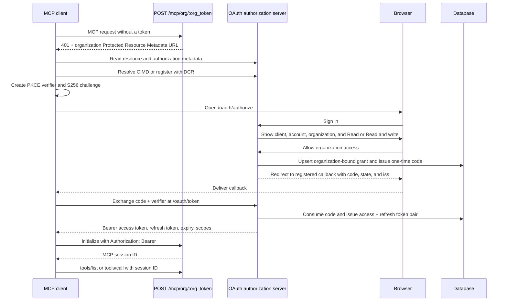

# MCP OAuth architecture

This document explains how PostDeploy authorizes remote MCP clients, binds each connection to one organization or legacy project, issues and rotates credentials, resolves request-local project context, enforces scopes, and removes access.

## Goals

The MCP authorization system provides:

- OAuth authorization-code grants with S256 PKCE.
- Browser sign-in with explicit organization access consent.
- One organization-bound grant per active client connection, covering all current and future projects.
- Short-lived access tokens and rotating refresh tokens.
- OAuth discovery for MCP clients.
- Client identification through Client ID Metadata Documents (CIMD), with Dynamic Client Registration (DCR) for compatible clients.
- Per-request grant, membership, resource, token, and scope checks.
- Owner/admin visibility and revocation in Organization Settings.

Static MCP credentials are not supported. An MCP client must complete OAuth and send the resulting access token in the HTTP `Authorization` header.

WebMCP is separate. It uses the signed-in browser session and CSRF protection under `/dashboard/webmcp/*`; it does not use remote MCP access tokens.

## Public endpoints

The default MCP resource is organization-qualified:

```text
https://<host>/mcp/org/<organization-public-token>
```

The legacy project-pinned resource remains available during the compatibility period:

```text
https://<host>/mcp
```

OAuth uses these endpoints:

| Purpose | Endpoint |
|---|---|
| Organization MCP resource | `POST /mcp/org/:org_public_token` |
| Legacy MCP resource | `POST /mcp` |
| Organization Protected Resource Metadata | `GET /.well-known/oauth-protected-resource/mcp/org/:org_public_token` |
| Legacy Protected Resource Metadata | `GET /.well-known/oauth-protected-resource/mcp` |
| Compatibility Protected Resource Metadata | `GET /.well-known/oauth-protected-resource` |
| Authorization Server Metadata | `GET /.well-known/oauth-authorization-server` |
| Authorization and consent | `GET /oauth/authorize`, `POST /oauth/authorize` |
| Device authorization | `POST /oauth/device_authorization` |
| Device code entry and consent | `GET /activate`, `POST /activate` |
| Token exchange and refresh | `POST /oauth/token` |
| Token revocation | `POST /oauth/revoke` |
| Dynamic Client Registration | `POST /oauth/register` |

`Alplus.Mcp.OAuth` derives every URL from `AlplusWeb.Endpoint.url/0`. The configured endpoint host and organization token are part of the resource identity. A client must use the advertised resource URL exactly. Changing the host, scheme, organization token, or path creates a different resource.

## Discovery

An unauthenticated MCP request receives HTTP `401` and a `WWW-Authenticate: Bearer` challenge. The challenge points the client to Protected Resource Metadata.

Protected Resource Metadata advertises:

- The exact organization-qualified or legacy MCP resource URI.
- The authorization server issuer.
- Header-based bearer transport.
- Every supported MCP scope.

Authorization Server Metadata advertises:

- Authorization, token, revocation, and registration endpoints.
- Authorization-code and refresh-token grants.
- Mandatory S256 PKCE support.
- Public clients (`token_endpoint_auth_methods_supported: ["none"]`).
- CIMD support.
- The complete scope vocabulary.
- The authorization response `iss` parameter.

The RFC 9728 metadata path preserves the complete resource path. Organization resources use `/.well-known/oauth-protected-resource/mcp/org/:org_public_token`. The root well-known path remains available for legacy compatibility.

## Client identification

### Client ID Metadata Documents

A CIMD client uses an HTTPS metadata-document URL as its `client_id`. `Alplus.Mcp.OAuth.ClientMetadata`:

1. Validates that the client ID is an HTTPS metadata URL.
2. Fetches it through the SSRF-hardened ExMCP metadata fetcher.
3. Requires the document's `client_id` to equal the requested URL exactly.
4. Validates every redirect URI.
5. Caches the validated client by `(issuer, client_id)` for one hour.

CIMD redirect URIs must use HTTPS, except that loopback HTTP redirect URIs are allowed for native clients. Userinfo and fragments are rejected.

### Dynamic Client Registration

Clients that do not use CIMD can call `POST /oauth/register`. Registration returns an opaque `mcocl_*` client ID and never returns a client secret.

DCR validates all redirect URIs before storing the client. HTTPS hosts must be valid DNS names or IP literals. HTTP is accepted only for loopback hosts. Wildcards and CSP-significant host syntax are rejected.

DCR is a compatibility path. The authorization and token flows are the same after the client record exists.

## Authorization-code flow



### Authorization request validation

An authorization request must provide:

- `response_type=code`.
- A known client ID.
- An exactly registered redirect URI.
- The exact MCP resource URI.
- A nonempty state no longer than 512 bytes.
- A valid PKCE challenge.
- `code_challenge_method=S256`.
- A supported scope string.

When the client and redirect URI are valid, malformed requests return an OAuth error to the registered callback. Unsupported scopes return `error=invalid_scope`; other malformed requests return `error=invalid_request`. The response includes a valid original `state` when one was supplied and always includes `iss`.

The authorization server does not redirect to an unregistered URI. If the client or redirect cannot be trusted, it returns a local HTTP 400 response.

## Sign-in and consent

A signed-out authorization request is stored as `return_to` and resumes after sign-in. Client metadata is not fetched before sign-in for a syntactically valid request.

A signed-in owner or admin sees:

- The client name and client host or registered-application label.
- The signed-in account email.
- The organization fixed by the organization-qualified resource URI.
- Read or Read and write access.
- A statement that the grant covers every current and future project.
- Allow and Cancel actions.

The organization token in the resource URI fixes the organization before consent. The server verifies that the signed-in user is a live owner or admin in that organization. A submitted organization or project field cannot widen the grant.

The legacy `/mcp` consent form still allows an owner or admin to select one project and narrow the requested capability scopes.

The validated authorization request is stored in the signed session. The POST reads it without consuming it first. It is deleted only after a successful Allow or Cancel redirect. An invalid selection re-renders consent and preserves the request for retry.

The browser pipeline applies CSRF protection. Consent also uses a nonce-based Content Security Policy. The global policy normally permits forms only to submit to the same origin. Because a successful consent POST redirects to the client's callback, the consent response adds only the validated callback origin to `form-action`. Paths and query strings never enter the CSP source.

## Grants and project resolution

Allow creates or updates an active `Alplus.Mcp.OAuthGrant`. The active organization connection identity is:

```text
organization + scope mode + user + OAuth client + resource
```

An organization grant records:

- Issuer and the exact organization-qualified MCP resource.
- User and organization.
- `scope_mode=organization` with no stored project ID.
- OAuth client.
- Granted scopes.
- Creation, last-use, and revocation timestamps.

Organization grants cover every live project that currently belongs to the grant organization. They do not store a project list. New projects become available automatically. Archived, deleted, moved, and foreign projects fail as `not_found`.

Every project-scoped `actions.read`, `actions.write`, `actions.publish`, and `actions.destroy` call under an organization grant must include top-level `project_ref`. The gateway accepts an immutable project ID or public token, resolves it inside the grant organization, removes nested project fields, and injects the internal project handle before dispatch. Missing context returns `project_required`. No MCP session or prior call stores project authority.

`context.get` lists and searches organization projects with `query`, `cursor`, and `limit`. `project_ref` returns one exact project context. It also returns the organization, access mode, scopes, and product areas.

Legacy `/mcp` grants retain their pinned project. They may omit `project_ref`; a supplied reference must resolve to that pinned project.

Re-authorizing the same active connection updates its scopes. Revoked grants remain as historical records, while a later connection creates a new active grant.
## Scope model

`Alplus.Mcp.Scope` owns the tool-to-scope mapping:

| Tool family | Read scope | Write scope |
|---|---|---|
| `projects.*` | `projects:read` | — |
| `changelog.*` | `changelog:read` | `changelog:write` |
| `measure.*` | `analytics:read` | `analytics:write` |
| `monitor.*` | `monitor:read` | `monitor:write` |
| `observe.*` | `errors:read` | `errors:write` |
| `status.*`, `public.*` | `status:read` | `status:write` |

The default requested scope is `projects:read`. Discovery advertises the complete vocabulary.

Scope enforcement is defense in depth:

1. The HTTP scope gate checks the JSON-RPC method and tool name before dispatch.
2. `Alplus.Mcp.Dispatch` checks the same mapping again at the application boundary.
3. Domain adapters enforce organization and project authorization through their scoped actors.

A missing scope returns MCP `insufficient_scope` information rather than silently widening access.

## Authorization codes and tokens

Raw codes and tokens are returned once. PostDeploy stores only SHA-256 hashes plus short lookup prefixes.

| Credential | Prefix | Lifetime | Notes |
|---|---|---:|---|
| Authorization code | `mcoac_` | 60 seconds | One-time use; consumed under a database lock |
| Device code | `mcodc_` | 15 minutes | One-time use; polled at a 5-second interval |
| Access token | `mcoat_` | 1 hour | Sent as `Authorization: Bearer` |
| Refresh token | `mcort_` | 30 days | Rotated on every successful refresh |

The code is bound to the client, redirect URI, MCP resource, grant, scopes, and PKCE challenge. Code consumption and token issuance run in one transaction, so concurrent exchanges have one winner.

The token endpoint supports:

- `grant_type=authorization_code` with code, verifier, client ID, redirect URI, and resource.
- `grant_type=refresh_token` with refresh token, client ID, and resource.
- `grant_type=urn:ietf:params:oauth:grant-type:device_code` with device code, client ID, and resource.

Public clients do not authenticate with a client secret. Their security comes from exact redirect registration, PKCE, one-time codes, resource binding, and refresh-token rotation.

## Device authorization grant

The authorization-code flow needs a browser on the client's own host and a
loopback port it can bind. An agent on a remote machine, in a container, or in
CI has neither, so it uses RFC 8628 instead.

1. The client posts `client_id`, `resource`, and `scope` to
   `POST /oauth/device_authorization`.
2. PostDeploy returns a secret `device_code`, a readable `user_code`, the
   verification address, the lifetime, and the poll `interval`.
3. A person opens `/activate` on any device and types the user code. The same
   consent screen as the authorization-code flow selects the organization,
   project, and permissions.
4. The client polls the token endpoint. It receives `authorization_pending`
   until approval, `slow_down` if it polls faster than the interval,
   `access_denied` if the person refuses, and `expired_token` after 15 minutes.

Throttling applies only while the request is pending, so an approved client
never waits an extra interval for its tokens. The device code is consumed when
tokens are issued.

The user code uses a 20-character consonant alphabet, so a generated code
cannot read as a word and cannot be confused when copied from another screen.

## Refresh rotation and replay

A successful refresh:

1. Locks the presented refresh-token row.
2. Confirms the token, client, resource, scopes, and grant are still valid.
3. Marks the old refresh token rotated.
4. Issues a new access and refresh token pair.

Presenting a rotated token again is normally replay and revokes the grant
family. Two legitimate cases look identical, and no client can prevent either:
the token response was lost in transit, and the client retried; or the client
crashed between receiving the successor and storing it.

So a rotated token presented within `@refresh_reuse_grace_seconds` (30 seconds)
rotates its unused successor and returns a fresh pair instead of revoking. Two
conditions keep replay detection alive:

- Outside the window, the presentation revokes the family.
- Once the client has rotated past the successor, the presentation is a fork
  rather than a retry, and it revokes the family even inside the window.

The window is also the time an attacker has to use a stolen predecessor, so it
stays near the length of one retry. A client that keeps a stale copy in a
second process can re-read its own store, so the window deliberately does not
cover that case.

An explicitly revoked token returns `invalid_grant` without letting an old
token revoke a legitimate successor family.

## MCP request authentication

`Alplus.Mcp.Authorization` accepts only an HTTP header in this form:

```http
Authorization: Bearer mcoat_...
```

Query-string credentials (`token`, `access_token`, or `api_key`) are rejected. Legacy `mcred_*` static credentials never authenticate.

Every access-token request rechecks:

- Token hash, expiry, and revocation.
- Grant existence and revocation.
- Issuer and exact resource.
- Stored token and grant scopes.
- Current organization membership.
- A valid scope mode: one pinned project for legacy grants, or no stored project for organization grants.

Invalid, expired, and revoked credentials do not reveal which condition failed. They use the same invalid-credential delay to avoid a revocation oracle.

After authentication, the MCP client calls `initialize`. The legacy MCP transport returns `Mcp-Session-Id`; later `tools/list` and `tools/call` requests must send it with the bearer token and protocol version.

## Revocation and connected clients

`POST /oauth/revoke` accepts an access or refresh token and returns success without revealing whether the token existed.

Organization Settings lists active connected MCP clients for owners and admins. Each row shows the client, account, organization, access level, project scope, connection time, last use, and revoke action. Organization grants show `All projects`. The page never renders raw codes, tokens, or hashes. Revocation requires typed confirmation.

Revoking a grant marks it revoked and invalidates its live access and refresh tokens. The next MCP request fails authentication. Grant authorization, revocation, and token use are audited with the grant identity.

## Retention

`Alplus.Billing.DataPurgeWorker` calls `Alplus.Mcp.OAuth.prune_expired/0`.

Pruning deletes:

- Expired authorization codes.
- Expired device codes.
- Expired access tokens.
- Expired refresh tokens.
- Refresh tokens whose revocation or rotation timestamp is older than seven days.

Active grants and recent rotation/revocation evidence remain available for management and replay handling.

## Telemetry and secret handling

OAuth secrets must not enter logs, telemetry, documentation examples, or UI output.

`AlplusWeb.Plugs.RedactedTelemetry` filters authorization codes, PKCE values, access tokens, refresh tokens, generic token parameters, raw query strings, the `Authorization` header, and cached raw request bodies. Application logging and MCP audit sanitization use the same boundary.

Never print an Inspector API token, OAuth credential, session cookie, or `.env` content while debugging.

## Static-credential cutover

The OAuth cutover removed `Alplus.Mcp.Credential`, its mint/revoke actions, the `mcp_credentials` table, static-token UI, and static-token configuration. Grant IDs now identify remote MCP activity, idempotency records, changelog writes, source references, and audit records.

There is no dual-auth fallback. Keeping HTTP Bearer transport does not mean static credentials remain: the bearer value is now an OAuth access token whose grant is revalidated on every request.

## Main modules

| Responsibility | Module |
|---|---|
| Public OAuth API and endpoint URLs | `Alplus.Mcp.OAuth` |
| Authorization, token, refresh, and revoke flow | `Alplus.Mcp.OAuth.Flow` |
| CIMD validation and cache | `Alplus.Mcp.OAuth.ClientMetadata` |
| Grant resource and policies | `Alplus.Mcp.OAuthGrant` |
| Code/access/refresh/device resources | `Alplus.Mcp.OAuthAuthorizationCode`, `OAuthAccessToken`, `OAuthRefreshToken`, `OAuthDeviceCode` |
| Browser authorization and consent | `AlplusWeb.OAuthAuthorizationController`, `AlplusWeb.OAuthActivationController`, `AlplusWeb.OAuthConsent` |
| Device authorization endpoint | `AlplusWeb.OAuthDeviceController` |
| Token and revocation HTTP endpoints | `AlplusWeb.OAuthTokenController`, `AlplusWeb.OAuthRevocationController` |
| DCR endpoint | `AlplusWeb.OAuthRegistrationController` |
| OAuth discovery | `AlplusWeb.McpDiscoveryController` |
| Bearer boundary | `Alplus.Mcp.Authorization`, `AlplusWeb.Plugs.McpAuth` |
| Tool scope decisions | `Alplus.Mcp.Scope`, `AlplusWeb.Plugs.McpScopeGate` |
| Connected clients UI | `AlplusWeb.SettingsLive` |
| Retention | `Alplus.Billing.DataPurgeWorker` |

## Verification

The automated suite covers discovery, organization and legacy audiences, DCR, CIMD hardening, redirect validation, OAuth error redirects, PKCE, organization consent, live membership checks, request-local project resolution, project isolation, legacy project pinning, code-exchange concurrency, refresh replay and the reuse grace window, the device grant loop (pending, slow down, deny, expiry, single use), revocation, scope enforcement, pruning, connected-client management, static-token rejection, and WebMCP preservation.

Before the gateway cutover, MCP Inspector 2.4.0 completed the real browser flow
locally through the legacy `projects.list` tool:

1. Opened PostDeploy authorization for `http://localhost:4000/mcp`.
2. Signed in and allowed `projects:read` for one project.
3. Followed the registered loopback callback.
4. Completed `initialize` with MCP `2025-11-25`.
5. Completed `tools/list`.
6. Called `projects.list` and received the granted project as structured output.

The current wire contract replaces that final call with `context.get` and
exposes only the eight gateway tools.

For repeatable procedures and deployed-client checks, see `docs/runbooks/mcp-agent-acceptance.md`.
